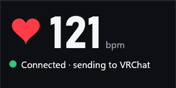
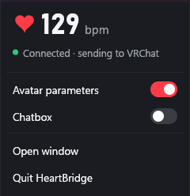

# HeartBridge

Sends the heart rate from a Bluetooth chest strap to VRChat over OSC, either to the chatbox, to avatar parameters, or both.

It started with a GEOID HS500, but any strap that broadcasts the standard Bluetooth heart rate service should work (most Polar, Coospo, Wahoo and similar straps do). Runs on Windows, Linux and macOS.


## Getting it

Every push to `main` is built for Windows, Linux and macOS by GitHub Actions. Open the latest run under [Actions](../../actions) and download the file for your system (you need to be signed in to GitHub).

Or build it yourself with a stable [Rust](https://rustup.rs) toolchain:

```sh
git clone https://github.com/setsumi-vrc/heartbridge
cd heartbridge
cargo build --release
```

The binary ends up in `target/release/`.

**Linux:** no extra packages are needed to build. At runtime it needs BlueZ (the `bluetooth` service running) and, for the tray icon, a panel that supports StatusNotifierItem. KDE has one built in; GNOME needs the AppIndicator extension. Without a tray the app still works, and closing the window minimizes it instead.

**macOS:** the first scan triggers a Bluetooth permission prompt for the app you started it from (Terminal, iTerm and so on).

## Setup

1. Wet the strap's electrodes and put it on. It only accepts one connection at a time, so close the phone app if it's connected there.
2. Start HeartBridge. It finds the strap and connects on its own.
3. In VRChat, open the Action Menu, go to Options → OSC, and enable it.

## Avatar parameters

These use the same names as HRtoVRChat_OSC, so avatars and prefabs built for it work as they are.

| Parameter | Type | Value |
|---|---|---|
| `HR` | int | Beats per minute |
| `onesHR`, `tensHR`, `hundredsHR` | int | Each digit of the BPM |
| `floatHR` | float | BPM scaled to 0–1 (0–255 bpm) |
| `isHRConnected` | bool | The strap is connected |
| `isHRActive` | bool | Readings are coming in |
| `isHRBeat` | bool | Flips on for each beat |

## Chatbox

The chatbox is off by default, because everyone in the instance can see it. The text is a template where `{bpm}`, `{zone}` and `{bat}` (strap battery) get replaced, for example `❤ {bpm} bpm`. VRChat rate-limits the chatbox, so the text is sent every 2 seconds.

## Tray and compact mode

Closing the window hides it to the tray and it keeps sending. Left-click the tray icon to show or hide the window. Right-click it for the chatbox and parameter switches and Quit.

The compact button in the title bar shrinks the window to 300×150, which is handy for an OBS window capture or a VR overlay such as XSOverlay or OVR Toolkit.

<p>
  
  
</p>

## Troubleshooting

**Stuck on "Looking for the strap…".** Wet the electrodes again, check that no phone or watch is holding the connection, and check that Bluetooth is on. If your strap doesn't advertise the heart rate service, type part of its name in Settings → Strap name.

**VRChat doesn't react.** Make sure OSC is enabled and the port in Settings matches VRChat's (9000 by default). If you just added the parameters to an avatar, reset its OSC config (Action Menu → Options → OSC → Reset Config), because VRChat caches it per avatar.

**Anything else.** The bug icon in the title bar opens a debug window with the raw packets from the strap, what's being sent over OSC, and an event log. Use Copy log to include it when you report an issue.

## Settings file

| System | Location |
|---|---|
| Windows | `heartbridge.json` next to the executable |
| macOS | `~/Library/Application Support/HeartBridge/heartbridge.json` |
| Linux | `~/.config/heartbridge/heartbridge.json` |

Set `HEARTBRIDGE_DEMO=1` to run with a simulated pulse, without a strap.
