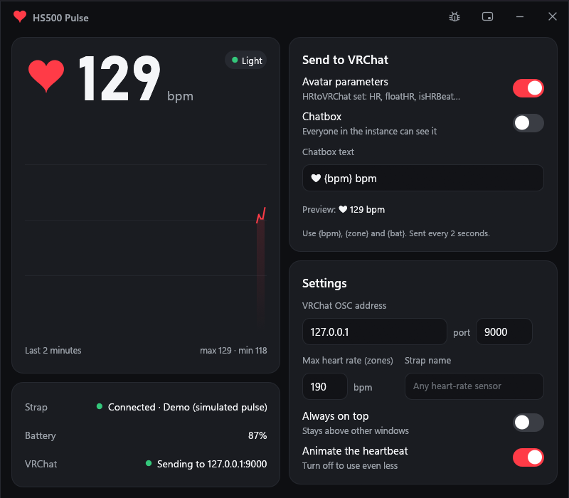

# HS500 Pulse

Sends your heart rate from a Bluetooth chest strap to VRChat over OSC: to the chatbox, to avatar parameters, or both. Built for the GEOID HS500, and works with any strap that uses the standard Bluetooth Heart Rate service.

A single native Windows app written in Rust (egui). It redraws only when new data arrives, so it stays light while VRChat runs.



## Run

```bash
cargo run --release
```

Requires Windows 10/11 with Bluetooth LE and a recent stable Rust toolchain.

1. Put the strap on and wet the electrodes so it wakes up. Close any phone app that is connected to it, because the strap accepts only one connection.
2. The app finds the strap and connects on its own.
3. In VRChat, turn on OSC: Action Menu → Options → OSC → Enabled.

## What it sends

**Avatar parameters** (on by default) use the community HRtoVRChat names, so existing heart-rate prefabs work without changes:

| Parameter | Type | Meaning |
|---|---|---|
| `HR` | int | Beats per minute |
| `onesHR`, `tensHR`, `hundredsHR` | int | Individual digits |
| `floatHR` | float | BPM mapped to 0–1 (0–255 by default) |
| `isHRConnected` | bool | The strap is connected |
| `isHRActive` | bool | A live reading is arriving |
| `isHRBeat` | bool | Pulses on every beat |

**Chatbox** (off by default, because everyone in the instance can see it): an editable template that supports `{bpm}`, `{zone}` and `{bat}`. It is sent every 2 seconds.

## Windows

- **Main window:** shows the pulse, the last 2 minutes, connection status, and the VRChat and settings cards.
- **Compact mode:** a 300×150 window for OBS window capture or a VR overlay (XSOverlay, OVR Toolkit, Desktop+).
- **Tray:** the icon shows the live BPM.
  - Left click shows or hides the window.
  - Right click opens a menu with the two VRChat switches, *Open window* and *Quit*.
  - Closing the window hides it to the tray, and sending continues.
- **Debug window:** the bug icon in the title bar opens it. It shows the raw packets, the OSC state and an event log you can copy.

## Settings

Settings are saved to `hs500-pulso.json` next to the executable. They cover:

- the OSC host and port (default `127.0.0.1:9000`)
- your max heart rate, which sets the zones
- a strap-name filter
- always on top
- the heartbeat animation

For testing without a strap, set `HS500_DEMO=1` to get a simulated pulse.
